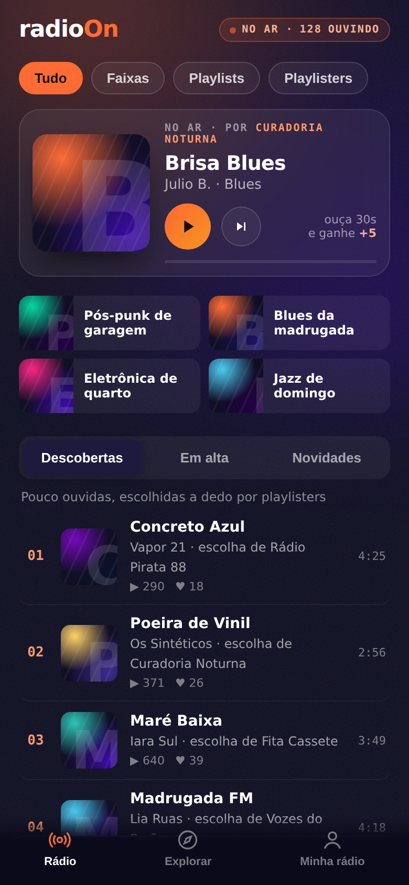
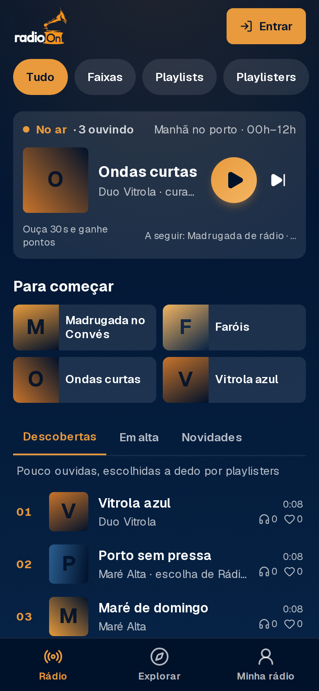
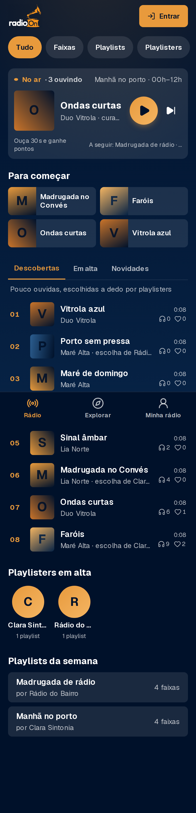
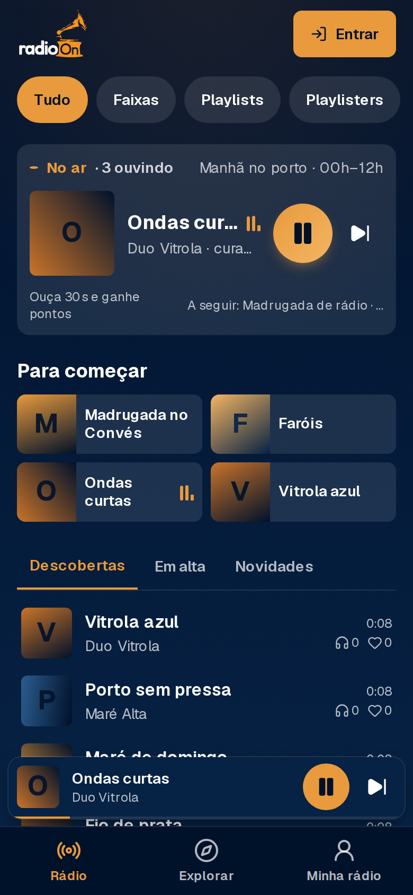
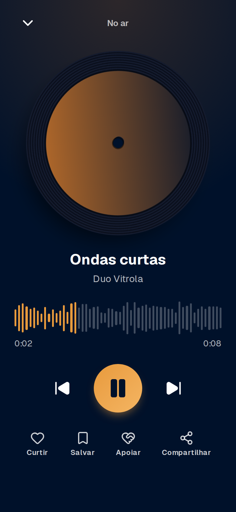
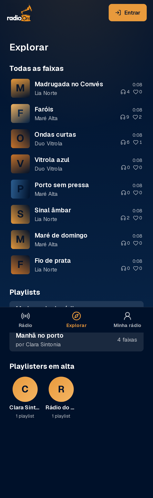

# Relatório — correções do teste no celular (2026-11-10)

## O que estava quebrado e por quê
1. **Nada tocava (causa certa, corrigida).** No player global, `onTimeUpdate` lia
   `e.currentTarget` dentro do `setState`; o valor já era `null` e o React derrubava a página
   inteira ("This page couldn't load") na primeira reprodução. Reproduzi localmente com faixas de
   demonstração e confirmei a correção.
2. **Faixa em Minha rádio, mas não na Rádio/Explorar (causa provável, reforçada).** A consulta
   da Rádio usava embeds e novas colunas numa só chamada e descartava erros. Agora cada leitura é
   independente, sem embeds, com fallback (colunas base, depois service_role só com
   `status = published`) e log de erro no servidor. A rota de play segue a mesma regra.
   *Não consegui provar contra o banco real (o agente não tem credencial); confirme com sua faixa.*

## Entregue
| # | Item | Onde |
|---|------|------|
| 0 | Protótipo já estava na main; usei só navegação/hierarquia (paleta marinho/âmbar) | `docs/prototipo-mobile.html` |
| 1 | Toda faixa publicada na Rádio e no Explorar, toca de qualquer aba | `lib/radio/queries.ts`, play route |
| 2 | Catálogo de demo (prévias/local) + 6 E2E novos, **nenhum pulado** | `lib/radio/demo.ts`, `e2e/` |
| 3 | Dica sob as abas, numeração 01/02, "escolha de <playlister>" (resto já existia) | `components/lista-faixas.tsx` |
| 4 | Envio: MP3/M4A/AAC/OGG/FLAC/WAV/MP4 por extensão+tipo, `accept` explícito, capa até 15 MB → WebP ≤ 1200 px, barra de progresso | `lib/storage/formatos.ts`, `upload-form.tsx` |
| 5 | Login → Rádio (ou destino); "Abrir e-mail" Gmail/Outlook; botão Google pronto | `app/login/`, `login-form.tsx` |
| 6 | PWA instalável + Web Share Target de áudio | `app/manifest.ts`, `public/sw.js`, `/compartilhar` |

Decisões 41–45 em `docs/DECISIONS.md`. Migrations: **nenhuma** nova.

## Capturas 390×844 (catálogo de demonstração)
Comparação com o protótipo (`prototipo-radio.png`): mesma ordem — filtros, "No ar", grade 2×2,
abas, lista, playlisters, playlists, mini player e player cheio — em marinho/âmbar.
Diferenças assumidas: o protótipo tem busca/"por clima"/gêneros no Explorar (vai com o item k) e
barra de progresso no cartão No ar.

## Passo a passo — "Entrar com Google" (gratuito)
1. Google Cloud Console → criar projeto → *APIs e serviços → Tela de consentimento OAuth*
   (Externo; nome radioOn; e-mail de suporte; domínio radioon-ten.vercel.app).
2. *Credenciais → Criar credenciais → ID do cliente OAuth → Aplicativo da Web*. Em
   **URIs de redirecionamento autorizados** cole o *Callback URL* que o Supabase mostra em
   *Authentication → Providers → Google* (formato `https://<ref>.supabase.co/auth/v1/callback`).
3. Copie *Client ID* e *Client secret* para o Supabase (Providers → Google → ligar → salvar).
4. Supabase → *Authentication → URL Configuration*: Site URL `https://radioon-ten.vercel.app` e
   Redirect URL `https://radioon-ten.vercel.app/auth/callback`.
5. Vercel → variável `NEXT_PUBLIC_GOOGLE_LOGIN=1` (Production) e novo deploy. O botão aparece.

## Pendências e riscos
- Teste em produção com faixa real (causa 2 não provada contra o banco).
- Share target só no Android/Chrome com o app instalado; iOS não suporta.
- A capa passa a ter ≤ 1,5 MB; o limite do servidor continua 2 MB.
- Demo só em prévias/local; produção continua mostrando só o catálogo real.
