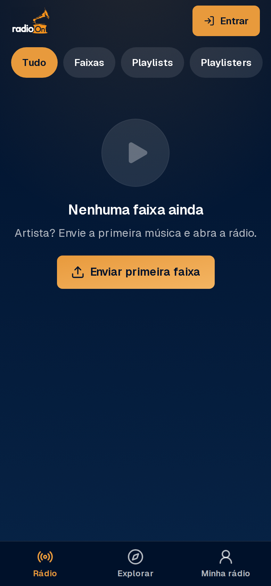
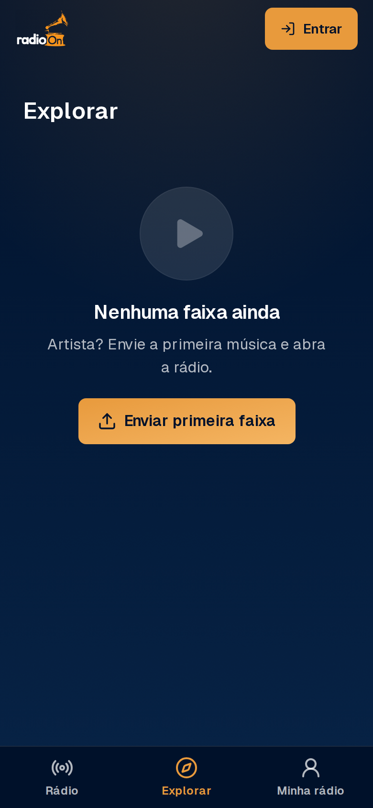
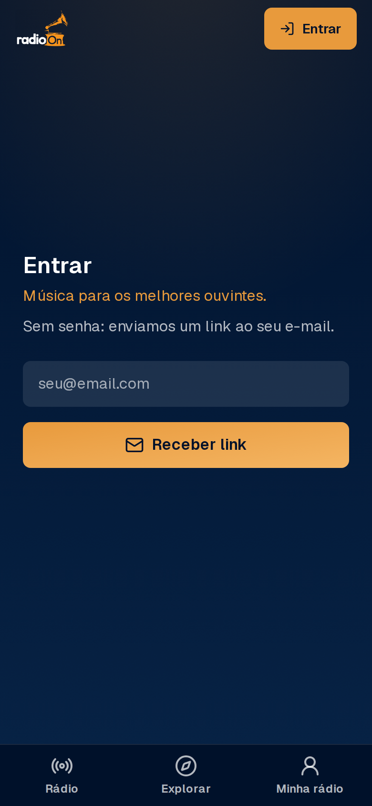
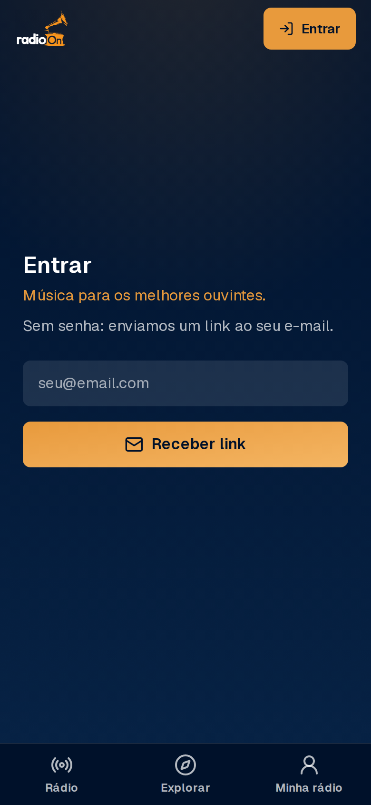

# Relatório 2026-11-10 — Redesenho mobile-first do radioOn

Dois PRs mergeados pelo gate e em produção: **#42** (identidade) e **#43** (Rádio, player,
envio e Minha rádio). Produção conferida: `/api/health` com o commit do #43, `/` e `/explorar`
em 200, migration `20261110000000` aplicada (workflow `migracao` verde).

## Atenção: as duas referências
- `Captura de Tela … 23.25.14.png` = **cartão da marca** (gramofone + "Música para os melhores
  ouvintes."). Foi para `public/brand/cartao-marca.png`.
- `WhatsApp Image … 23.02.58.jpeg` **não é o site de 2012**: é um print do **Audius** (aba
  Trending). Guardei em `public/brand/referencia-audius.jpeg` (não em `radioon-2012`, para não
  rotular errado) e usei só como referência de densidade de lista. **Se quiser a inspiração de
  2012, envie a captura certa**; notas do playlister e ficha técnica seguiram o texto do pedido.
- As imagens da raiz entraram na `main` pelo seu PR #41; as cópias da raiz foram removidas.

## Entregue (itens do pedido)
| # | Item | Onde |
|---|---|---|
| 1 | Paleta marinho `#00112A` + âmbar `#E89A3C`; texto sobre âmbar escuro | `app/globals.css`, DESIGN.md |
| 2 | Gramofone recortado com fundo transparente: cabeçalho, ícone do app, abertura | `public/brand/`, `app/icon.png`, `components/abertura.tsx` |
| 3 | Frase "Música para os melhores ouvintes." em login e onboarding | `components/frase.tsx` |
| 4 | Grão sutil + fundo ambiente na cor da faixa atual | `body::before/::after`, `--ambiente` |
| 5 | Navegação inferior: Rádio, Explorar, Minha rádio | `components/nav-inferior.tsx` |
| 6 | Rádio: filtros, cartão No ar, grade 2×2, abas Descobertas/Em alta/Novidades, Playlisters em alta, Playlists da semana | `app/page.tsx`, `lib/radio/` |
| 7 | "No ar · N ouvindo" (usuários distintos com heartbeat nos últimos 3 min) | `lib/radio/queries.ts` |
| 8 | Programação por horário (curador cria em /curador); No ar mostra atual e próximo | `programs`, `app/curador/` |
| 9 | Mini player fixo e persistente | `components/player-provider.tsx`, `mini-player.tsx` |
| 10 | Player cheio: vinil girando, onda de progresso, curtir, salvar, apoiar, compartilhar | `components/player-cheio.tsx` |
| 11 | Notas do playlister e ficha técnica expansível | player cheio, `/curador` |
| 12 | Envio com capa opcional (B2) e ficha opcional; sem capa, arte gerada do título | `components/upload-form.tsx`, `/api/tracks/[id]/capa` |
| 13 | Minha rádio (meta diária, escutas, minutos, descobertas; artista: faixas e Enviar) | `app/minha-radio/` (`/metricas` e `/pontos` redirecionam) |
| 14 | Todas as variáveis de ambiente lidas com trim | `lib/env.ts` |
| 15 | E-mails de confirmação e magic link em pt-BR | `docs/emails-autenticacao.md` |
| 16 | "Faixa bônus desbloqueada com pontos" como proposta | `docs/PLANO.md` (aguarda seu "aprovado") |

Decisões 33–40 em `docs/DECISIONS.md`; `DESIGN.md` e `PRODUCT.md` reescritos.

## Prints (produção, 390×844, catálogo ainda vazio)
O banco de produção não tem faixas publicadas, então o cartão No ar, as listas, o mini player e
o player cheio **não aparecem nos prints** (e o E2E "com faixas" é pulado na prévia). Foram
verificados por tipos, build e testes unitários, não visualmente. Depois da primeira faixa,
vale conferir esses fluxos no celular.

## Testes
- Unitários: 57 (ranking/tendência, descobertas, programação, "ouvindo", capa gerada, minha rádio,
  upload com capa e ficha, trim de env, validação de programa e nota).
- E2E (Playwright, viewport de celular): navegação de 3 abas, filtros, estado vazio, redirects de
  Minha rádio, frase da marca, 404 de faixa, rotas novas de API, manifesto e logo.

## Pendências e riscos
1. **Sem teste contra o banco:** policies de `track_reactions`/`programs` e as consultas da Rádio
   foram revisadas só por leitura. Faça uma escuta, um curtir e um bloco de programação logado.
2. **Cota do B2:** capas passam por redirect com cache de 15 min; ainda assim cada capa nova é um
   download. Se a cota apertar, desligue capas (basta não enviar) ou reduza para 1 h de cache.
3. **"Apoiar"** é só um gesto gratuito (reação), sem pagamento (regra 6).
4. "Em alta" e "N ouvindo" leem até 20 000 / 2 000 linhas com service_role a cada visita da Rádio;
   com muito tráfego, vale mover para uma view/cache (propor depois).
5. O limite de `listen_events` (heartbeat exige login) faz o "N ouvindo" contar só logados.
6. Seu Supabase Auth ainda precisa dos textos de `docs/emails-autenticacao.md` colados nos
   modelos (Confirm signup e Magic Link), e da Redirect URL do callback (pendência antiga).
